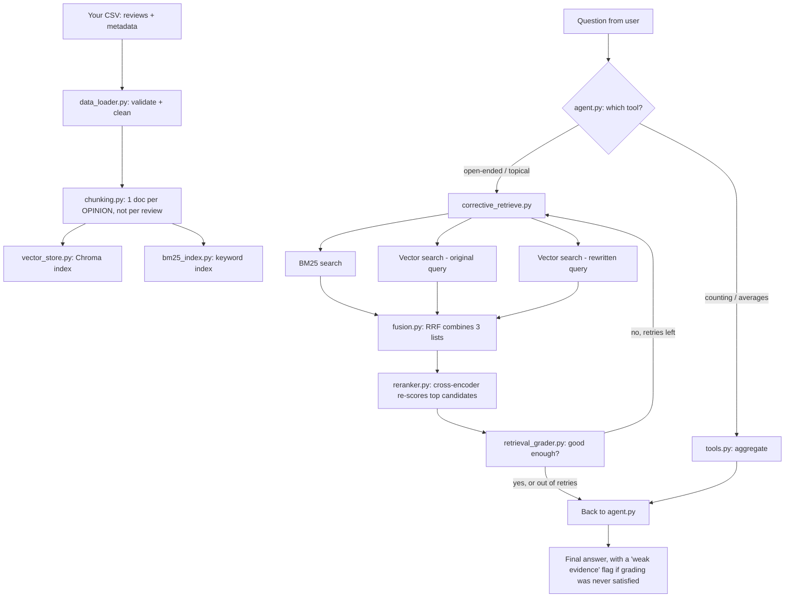

# VoC Review RAG Pipeline — Full Guide

What this is: a system that answers questions about customer reviews
(e-commerce, opinion-level, with brand/price/category/sentiment/theme
metadata). Built for prototyping — local vector store, local reranker,
OpenAI for the "thinking" parts.

---

## 1. The big picture



Two questions this pipeline is built to tell apart, always:
- **"What do people say about X"** → search (topical, fuzzy)
- **"How many / what's the average"** → math (exact, structured)

Sending the second kind of question to search is the #1 cause of
confident-sounding wrong answers. This pipeline routes them apart on
purpose.

---

## 2. Files, in the order data flows through them

### `config.py` — every setting, in one place
Nothing runs here, it's just numbers and names other files import.
Grouped into: which embedding model, which LLM, where Chroma saves data,
how many results to pull, and the retrieval-quality-checkpoint settings
(distance/rerank thresholds, retry limits). See section 4 below for the
full breakdown of what each setting does and how to tune it.

### `data_loader.py` — CSV in, clean table out
- Checks your CSV has all required columns (product_name, brand, price,
  category, review_text, opinion, opinion_sentiment, sentiment_score,
  opinion_theme, opinion_subtheme). Stops with a clear error if not.
- Makes `review_id` if missing, makes `opinion_id` always (one per row).
- Drops rows with a blank opinion. Fixes broken number cells instead of
  crashing on them.

### `chunking.py` — one row becomes one searchable "document"
Builds one document per **opinion**, not per whole review. A review
mentioning battery AND price AND comfort gets split into 3 separate
documents, each focused on one topic. This is what makes search
precise instead of blurry — mixing topics into one vector was the
"bad chunking" problem from your work experience that started this
whole build.

Each document has:
- `text` — a short sentence combining product/brand/opinion/sentiment/theme, this is what gets embedded and searched
- `metadata` — the same facts as structured fields (brand, price, sentiment_score, etc), used for filtering, not searching

### `vector_store.py` — talks to Chroma (the vector database)
- `index()` — saves documents to disk, embedding them first
- `search()` — given a question, returns the closest-matching documents,
  optionally filtered by metadata (e.g. only Brand X)
- This is the ONLY file that touches Chroma directly. If you ever move
  to a cloud vector database, this is the only file that changes.

### `bm25_index.py` — keyword search (the other half of hybrid search)
Catches exact-word matches that embeddings sometimes miss (model
numbers, specific brand spellings, exact phrases). Rebuilt fresh in
memory every time you run the pipeline — cheap, no model involved, just
counting words.

### `fusion.py` — combines search results from multiple sources
Implements **Reciprocal Rank Fusion (RRF)**: takes 3 separate ranked
lists (BM25 results, vector search on your question, vector search on
an AI-rewritten version of your question) and merges them into one
list, based on rank position — not raw scores, because BM25 scores and
vector distances aren't comparable numbers.

### `reranker.py` — a second, more careful look at the top results
Uses a local AI model (a "cross-encoder") that reads your question and
each candidate document TOGETHER, and scores how well they actually
match. More accurate than comparing two separate embeddings, but
slower — so it only runs on the top ~15 fused candidates, not everything.

### `retrieval_grader.py` — decides if search results are actually good
Two-stage grading:
1. Cheap check first — is the match score clearly good, or clearly bad?
2. Only "unsure" cases get sent to an AI model for a real judgment call.
This keeps cost down — most searches never need the AI check at all.

### `corrective_retrieve.py` — the full retrieval checkpoint, tying it together
Runs the whole sequence: search (BM25 + vector + vector-rewritten) →
fuse → rerank → grade. If grading says "not enough good matches," it
retries with an escalating strategy:
1. Search for more candidates
2. Drop metadata filters (maybe they were too narrow)
3. Rewrite the question differently, try once more
Gives up after a capped number of tries and returns whatever's best,
clearly marked as weak evidence rather than pretending it's solid.

### `tools.py` — the aggregate tool + tool descriptions for the AI
- `aggregate_tool` — pure pandas. Counts, averages, sums, grouped by
  brand/category/theme/sentiment. No AI, no embeddings — just math on
  your actual data. This is what answers "most negative themes" type
  questions, IF you have a sentiment column (see section 6).
- `TOOL_SCHEMAS` — tells the agent what tools exist and what arguments
  they take, in the format the AI model expects.

### `agent.py` — the decision-maker
Question comes in → AI model picks a tool (search or aggregate) → tool
runs → result comes back → AI decides: answer now, or try another tool
→ repeats up to a capped number of steps → final answer.

**Grounding check**: before answering, checks whether any tool actually
returned usable data this turn. If nothing did, it refuses instead of
guessing — this is the main defense against hallucination in this
pipeline.

### `main.py` — the command-line entry point
Loads your CSV, builds/reuses the vector index, builds the BM25 index,
starts a loop where you type questions and get answers.

### `calibrate_thresholds.py` — a helper, run once per new dataset
Prints out real distance scores for a known-good and known-bad query
against YOUR data, so you can set realistic thresholds in `config.py`
instead of using placeholder guesses.

---

## 3. Setup and running it

```bash
pip install -r requirements.txt
export OPENAI_API_KEY=sk-...        # or set OPENAI_BASE_URL for Azure
python main.py your_reviews.csv
```

First run builds the Chroma index (saved to `./chroma_db/`). Later runs
reuse it, unless you pass `--reindex`.

---

## 4. Every setting in `config.py`, what it does

| Setting | What it controls |
|---|---|
| `EMBEDDING_BACKEND` | "local" (free, on your machine) or "openai" (paid, more accurate) |
| `LLM_MODEL` | which AI model answers questions and grades borderline matches |
| `OPENAI_API_KEY` / `OPENAI_BASE_URL` | your credentials; base_url only needed for Azure |
| `CHROMA_DIR` / `COLLECTION_NAME` | where the vector index saves on disk, and its name |
| `TOP_K` | how many results to pull per plain search |
| `MAX_AGENT_STEPS` | hard cap on how many times the agent can loop before it must answer |
| `MIN_DOCS_TO_ANSWER` | absolute minimum results needed before attempting an answer |
| `DISTANCE_GOOD_THRESHOLD` / `DISTANCE_BAD_THRESHOLD` | cutoffs for plain vector-search grading (not used once reranking is added — see below) |
| `MIN_RELEVANT_DOCS` | how many "good" matches needed to call retrieval sufficient |
| `MAX_RETRIEVAL_RETRIES` | how many times to retry a weak search before giving up |
| `RETRY_K_MULTIPLIER` / `MAX_K_CAP` | how much to widen the search each retry, and the ceiling |
| `RRF_K` | fusion damping constant — rarely needs changing |
| `CANDIDATE_K` | how many results EACH retriever (BM25/vector/vector-rewritten) contributes before fusion |
| `RERANKER_MODEL` | which cross-encoder model reranks fused results |
| `RERANK_TOP_N` | how many fused results actually get reranked (cost control) |
| `RERANK_GOOD_THRESHOLD` / `RERANK_BAD_THRESHOLD` | cutoffs for reranked-result grading — **these are guesses, calibrate on your data** |
| `REQUIRED_COLUMNS` | the CSV column names your dataset must have |

---

## 5. What this pipeline is good and bad at

**Good at:**
- "What do customers say about X" — topical, fuzzy questions
- "How many / what's the average Y" — if the column exists
- Catching weak/wrong search results before they reach the answer
- Retrying automatically when the first search comes up empty

**Not built for (yet):**
- Multi-turn memory — every question is answered fresh, no "what about
  just the negative ones" follow-up context
- An automated eval harness — no Recall@k/Precision@k measurement yet,
  so retrieval quality is checked by hand, not tracked over time
- Fuzzy brand/category matching — filters need exact spelling matches
- Detecting when your CSV has changed and needs reindexing — you have
  to remember to pass `--reindex` yourself

---

## 6. One thing to know: sentiment must already exist in your data

"What are the most negative themes" is a full-dataset ranking question —
`aggregate_tool` answers it with pandas math, not search. But that only
works if `opinion_sentiment` is already a column in your CSV. If a
client hands you review data with no sentiment labels, this pipeline
can't invent them live — sentiment has to be computed once, upfront
(a classification pass over the raw text), same as how your ABSA work
already works. Trying to have the agent guess sentiment per question
from whatever 8-30 documents got retrieved would be answering from a
random slice of the data, not the real picture — worth refusing rather
than guessing in that case.
